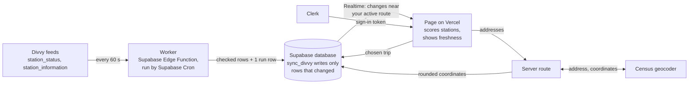

# Divvy Live

A commute app that helps rebalance Divvy bikes. Save named routes, activate one, and see the best places to pick up and drop off a bike right now. You earn more points for taking a bike from a full station and returning it to an empty one, within a half-mile walk of each end of your route. The page updates on its own.

**Live app:** https://divvy-live-git-main-luke-5ae6.vercel.app/

## Data flow

The original chart, made before any code, is in [`docs/data-flow.html`](docs/data-flow.html) and was the first commit. This is the same flow as GitHub draws it:



## How it works

1. **Source:** Divvy's public feeds, `station_status` and `station_information`, with no key needed.
2. **Worker:** a Supabase Edge Function in `supabase/functions/divvy-worker`, run every minute by Supabase Cron. It checks the feed, sends it to the database, and records each run in `worker_runs`. It runs every minute rather than every few seconds because Divvy's feed only refreshes every 60 seconds (its `ttl` is 60), so checking more often would find nothing new. The brief allows a slower schedule when the source changes slowly.
3. **Database:** the `sync_divvy` function writes only the stations that changed. Each person's routes are protected by row-level security.
4. **Page:** Next.js on Vercel. Supabase Realtime pushes changes for stations near the active route, and the browser recalculates the recommendations.

The page shows how recently the worker checked Divvy. If the data is more than 3 minutes old or the last check failed, it hides recommendations.

## Choosing trips

Each route can favor walking, points or a balance, set separately for each direction. Choosing a trip adds its points to your total on the Profile page, where you can compare with other riders on the leaderboard. The database works out the points, so scores can't be faked from the browser. It can't confirm a ride happened, so trips work on the honor system with one every 30 minutes. These points are this app's own estimate, not Bike Angels points.

## Running it

```
npm install
cp .env.example .env.local
npm run dev
```

Fill in `.env.local` with your Clerk and Supabase keys. `clerk env pull` fetches the Clerk ones.

## Tests

- `npm test` runs the worker on a saved copy of Divvy's response, plus the scoring and address rules.
- `supabase/tests/sync_divvy.sql` checks what the database saves, and `supabase/tests/choose_trip.sql` checks trips and the leaderboard. Both roll back their changes when they finish.

A class project for Design, Build, Ship. Not affiliated with Divvy or Lyft.
